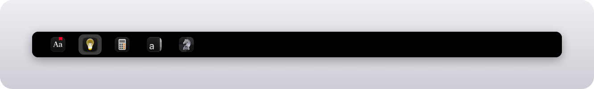

# WindowStrip

A bar in the strip left of the MacBook notch that shows the windows on the desktop you are looking at. One icon per window, grouped by app, with the front window highlighted. Hover an icon for the app and window title, and click it to bring that exact window to the front.



I used Stage Manager mostly to see which apps were open on each desktop, and it was clunky and buggy at that. WindowStrip puts that view in the menu bar instead.

## What it does

1. Each display with a notch gets its own bar, showing only the desktop (Space) it is on. Switching desktops slides the icons in from the side the new desktop is on.
2. Browser windows (Helium, Chrome, Brave, Edge, Chromium, Vivaldi) show up to three site icons of their open tabs, active tab first, in place of the browser icon.
3. The bar covers the app menus left of the notch. When an app's menus run past the notch, a second black panel covers the part on the right, so only the status items show there.
4. It hides on full-screen Spaces.
5. It stays under apps that draw around the notch at window level 26 or higher, such as Vorssaint's Dynamic Island (the one I use), and keeps its icons clear of them.

Only on-screen windows of regular apps get an icon, and only windows at least 80 by 60 points. Minimised windows, hidden apps and the windows of menu-bar apps don't show. When the bar runs out of room the icons get narrower, browser windows drop to one site icon, and whatever still doesn't fit is left off.

The app menus are still there under the bar. Press fn-Control-F2 (Control-F2 if your F keys work as standard function keys) to move focus to the menu bar. The highlighted menu, starting with the Apple menu, is hidden under the bar, so press Down to open it and Left and Right to move between menus. Shift-Command-/ opens the Help menu's search, which finds any menu item, and Raycast's Search Menu Items does the same.

## Requirements

1. A Mac with a notch. Displays without one get no bar.
2. The Xcode command line tools (`xcode-select --install`). Making a signing certificate (see Install) needs the full Xcode app.
3. macOS 14 or later. I have only run it on macOS 27.2.

## Install

```bash
git clone https://github.com/nizhunt/windowstrip.git
cd windowstrip
./build.sh --install
```

This builds WindowStrip.app into ~/Applications, starts it, and adds a login agent that starts it at every login and again if it ever exits. macOS will say a background item was added. That is the login agent, so leave it on in System Settings > General > Login Items (Login Items & Extensions on macOS 15 and later).

Then allow two permissions when macOS asks.

1. Accessibility (System Settings > Privacy & Security > Accessibility). Until you allow it, a click brings the whole app forward, the bar can't tell windows from an app's panels, tooltips show only the app name, menus right of the notch stay uncovered, and changes can take up to 2 seconds to show. It notices the permission within 10 seconds, without a restart.
2. Control of your browser, for the site icons. macOS asks once per browser, the first time one of its windows is on the bar.

build.sh signs the app with your Apple Development certificate when you have one, which keeps both permissions across rebuilds. Xcode makes one for any Apple ID (Xcode > Settings > Accounts > Manage Certificates). Without one it signs ad hoc, and macOS treats each rebuild as a new app, so after rebuilding you remove WindowStrip from the Accessibility list and allow it again, and macOS may ask about your browsers again. With several certificates it takes the first Apple Development one, and `SIGN_IDENTITY="<SHA-1 or full name>" ./build.sh` picks another (`security find-identity -v -p codesigning` lists them).

## Running it

It has no Dock icon or menu, so these commands manage it.

1. `launchctl print gui/$(id -u)/dev.windowstrip | grep state` shows whether it is running.
2. `launchctl kickstart -k gui/$(id -u)/dev.windowstrip` restarts it.
3. `launchctl bootout gui/$(id -u)/dev.windowstrip` stops it until the next login.
4. `launchctl bootstrap gui/$(id -u) ~/Library/LaunchAgents/dev.windowstrip.plist` starts it again.

The log is ~/Library/Logs/WindowStrip/WindowStrip.log. It is detailed by default, with a line for every change to the bar and every Accessibility notification, and rolls over at 8 MB. `defaults write dev.windowstrip quiet -bool true` and a restart keep it to the important lines.

To update, `git pull && ./build.sh` rebuilds it and restarts it.

## Uninstall

```bash
launchctl bootout gui/$(id -u)/dev.windowstrip
tccutil reset Accessibility dev.windowstrip
tccutil reset AppleEvents dev.windowstrip
rm ~/Library/LaunchAgents/dev.windowstrip.plist
rm -r ~/Applications/WindowStrip.app ~/Library/Caches/dev.windowstrip ~/Library/Logs/WindowStrip
defaults delete dev.windowstrip
```

If tccutil can't find the app, remove WindowStrip under Accessibility and Automation in System Settings > Privacy & Security.

## Privacy

Nothing leaves the Mac. The log never has window titles or tab addresses. It holds app, browser and display names, window numbers and positions, counts and timings. Tab addresses are only used to look up each tab's icon in the browser's own favicon database, and they stay in memory.

It keeps two other files. ~/Library/Caches/dev.windowstrip/state.json says what the bar shows, for the tests, with the same kind of detail as the log. ~/Library/Preferences/dev.windowstrip.plist remembers the order of apps on the bar. If you turn on `defaults write dev.windowstrip snapshots -bool true` and restart it, it also draws the bar and the open tooltip into PNG files next to state.json whenever a process posts the `dev.windowstrip.snapshot` notification. The tooltip picture can show a window title, which is why that is off by default.

## How it works

This part is for anyone who wants to change it.

1. The window list comes from the window server (CGWindowList), through a small helper process (wslist) inside the app bundle. CGWindowList can block for 300 to 400 ms while a window minimises, and meanwhile it holds the calling process's connection to the window server, which froze the bar's drawing while the call ran in the app itself.
2. Accessibility notifications (a window opened, closed, focused, minimised or restored) and workspace events (an app launched, quit, hidden or shown, a desktop switch) update the bar at once, and a fresh window list confirms it. When a browser window's title changes, its tabs are read again. A 2 second poll catches anything missed, and it stops while the screens are asleep or locked.
3. Private CoreGraphics calls (CGSCopyManagedDisplaySpaces, CGSCopySpacesForWindows) say which desktop each display shows, whether it belongs to a full-screen app, and which desktops a window is on. During a swipe the window list holds both desktops' windows, so the bar leaves out windows that are only on a desktop no display shows.
4. A click raises the window through the window server's own calls where they exist, as yabai, Hammerspoon and AltTab do, with Accessibility as the fallback. Each app gets its own queue, so a hung app can't hold up clicks on the others.
5. The panels sit at window level 26, ordered just under the notch apps' windows at the same level, and the icons stop short of whatever covers the notch.
6. Browser tabs come from Apple events sent to the browser, and their icons from the browser's Favicons database, opened read-only.
7. The panels belong on every desktop, and they stay on screen. On a full-screen app's desktop they turn transparent and let clicks through, and so does the cover right of the notch while it's off. A panel taken off screen there and put back as the full-screen app closed ended up on one desktop only. In case one still drops off a desktop, WindowStrip checks which desktops the panels are on whenever a shown one is missing from the window list and just after a full-screen app closes, and rebuilds them if one has.

Private APIs can break with any macOS update. If the bar is missing after one, `launchctl print gui/$(id -u)/dev.windowstrip | grep -E 'state|runs|last'` shows whether it keeps exiting (a rising runs count), and Crash Reports in Console show why. If only the window server's raise calls are gone, the log's start line says `windowServerRaise=false` and clicks go through Accessibility.

## Tests

`tests/run-tests.sh` runs 28 end-to-end tests against the running app, in about 35 seconds once its tools are built (the first run builds them). They move the pointer, click, open and close a test app's windows, switch desktops through Mission Control, take a window full screen and restart WindowStrip, so leave the Mac alone while they run.

1. Run them from a terminal that has the Accessibility permission, with the app installed through `./build.sh --install`. Without the permission the mouse tests and the desktop-switch test skip.
2. Run them on a desktop with only a few windows. The test app's icons go at the end of the bar, and on a full bar they are left off and the tests fail.
3. The desktop-switch tests need a second desktop and skip with one. They find Mission Control's desktop buttons by their English names, or by position when that is unambiguous, and skip when they can't find them.
4. Without a notch app the layering checks skip.
5. The every-desktop test (T28) turns on WindowStrip's test hook with the `testHooks` setting, uses it to take the bar off the other desktops, and checks that the bar comes back there. It removes the setting afterwards, and the hook does nothing without it.

`--only T04,T07` runs some of them, `--no-mouse` leaves out the ones that click and hover, and `--json tests/build/runs/run-1.json` saves the results. `tests/compare.py a.json b.json -- c.json d.json` compares the timings of two sets of runs, and `tests/measure.py watch 120` reads what WindowStrip costs the Mac (CPU, wakeups, disk writes, memory) from the kernel over two minutes.

## Layout

1. `Sources/` has the app. Controller.swift decides what the bar shows, AXWorker.swift does the Accessibility work, WindowLister.swift talks to the helper, Raise.swift brings windows forward, Tabs.swift reads browser tabs and their icons, and Views.swift draws the bar.
2. `Helper/main.swift` is the wslist helper, and `Shared/Spaces.swift` holds the Spaces calls both of them use.
3. `legacy/main.swift` is the first, polling version, kept as a timing baseline. `./build.sh --legacy` installs it in place of the current one, and `./build.sh` puts the current one back.
4. `tests/` has the end-to-end tests, the test app and the measuring tools.

## Licence

MIT, see [LICENSE](LICENSE).
